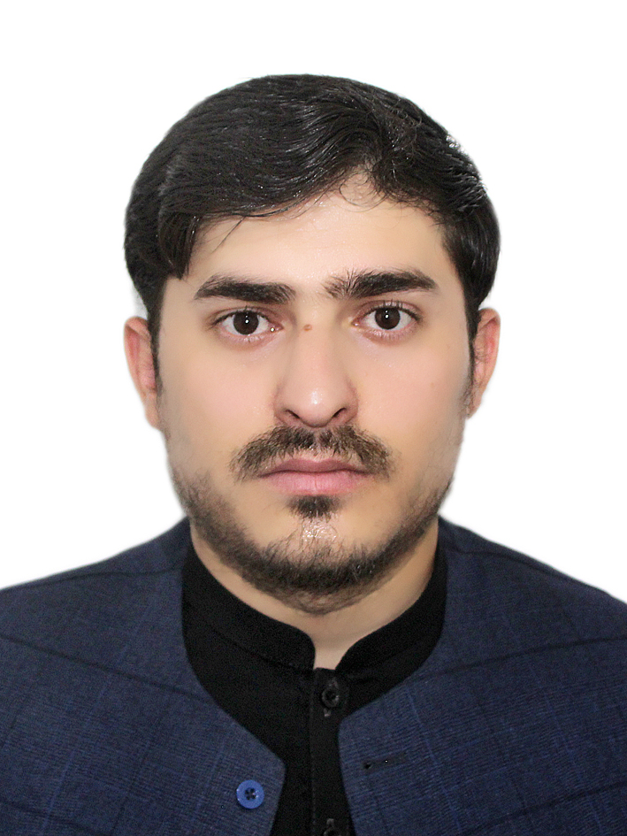
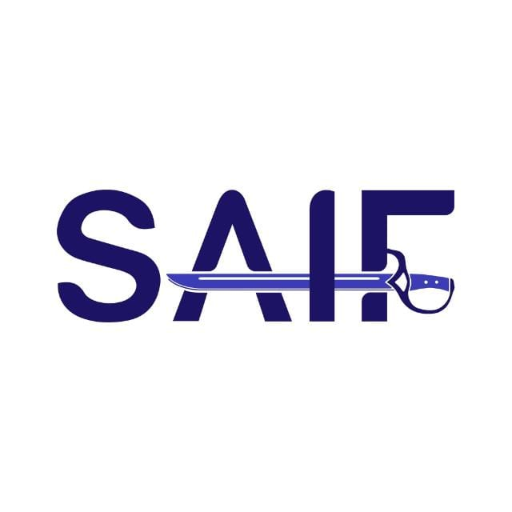
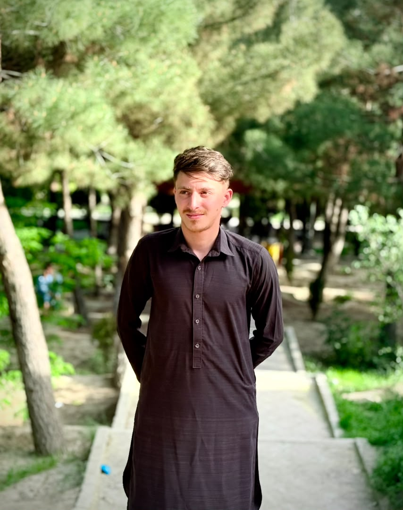
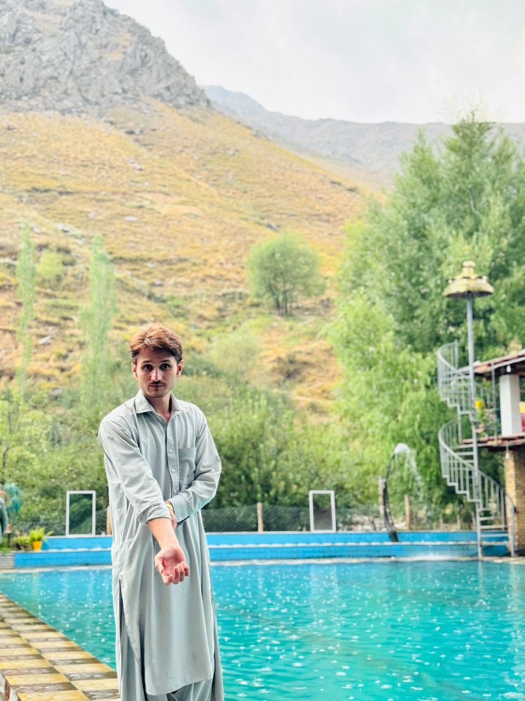
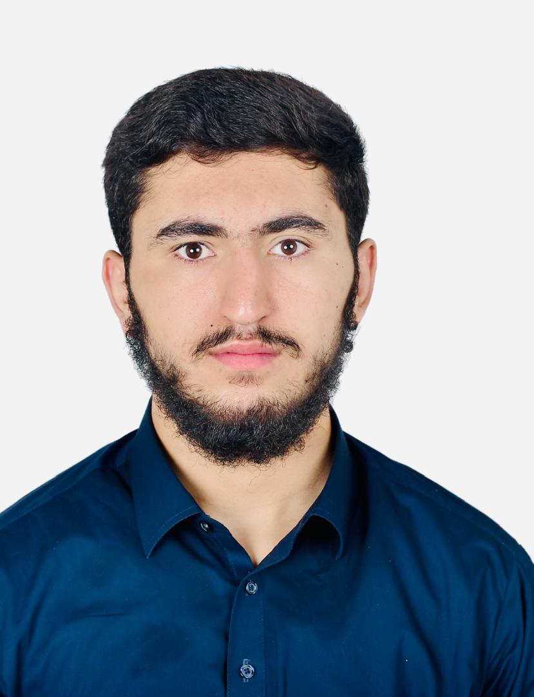

# Team

Layatanahi is built by a small, focused team that cares about *doing the work properly* — from planning and design to development and refinement. We believe great systems come from **consistent teamwork**, **clear communication**, and a commitment to quality at every stage.

## Meet the team

  

    
    
<strong class="font-semibold text-zinc-900 dark:text-zinc-100">Najeebullah Saleh</strong> Founder

  

  

    
    
<strong class="font-semibold text-zinc-900 dark:text-zinc-100">Saifullah Munqad</strong> Product Manager

  

  

    
    
<strong class="font-semibold text-zinc-900 dark:text-zinc-100">Musab Munqad</strong> CEO

  

  

    
    
<strong class="font-semibold text-zinc-900 dark:text-zinc-100">JASUR</strong> Marketing Manager

  

  

    
    
<strong class="font-semibold text-zinc-900 dark:text-zinc-100">Hedayatullah Samadee</strong> Designer

  

## Get in touch

> **Tip:** Questions about the product, a partnership, or support? We would love to hear from you — see the **[Contact Team](/docs/support/contact-team)** page.

## Related pages

- [Layatanahi Overview](/docs/layatanahi/overview)
- [Idea](/docs/layatanahi/idea)
- [Credits](/docs/layatanahi/credits)
