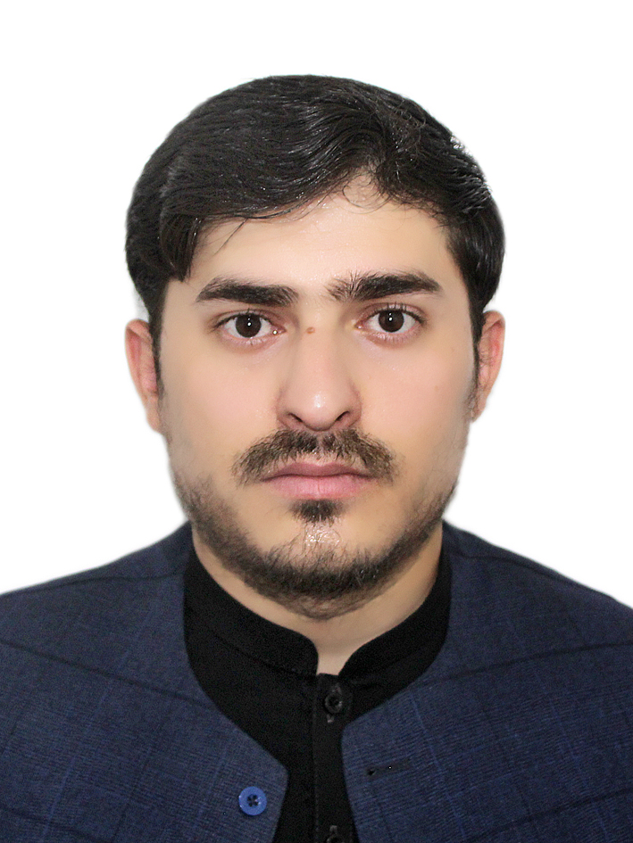
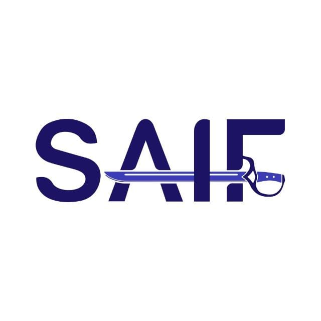
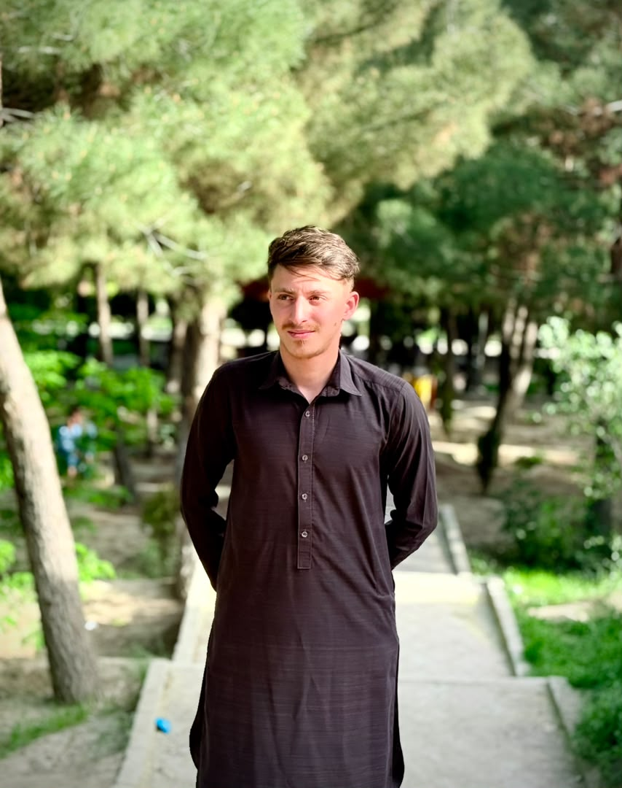
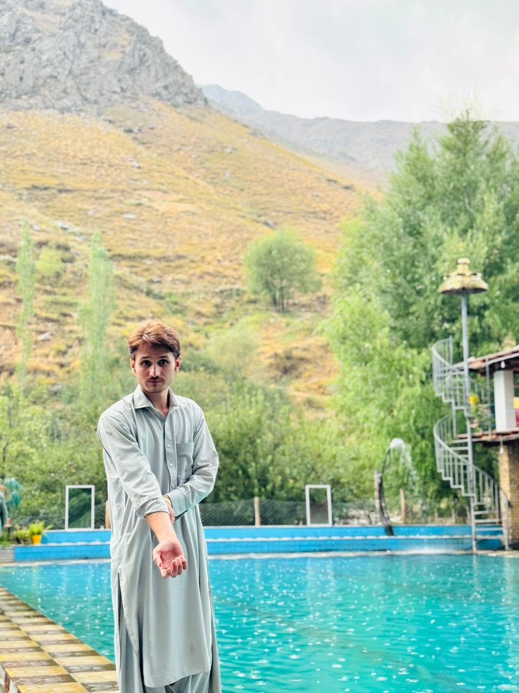
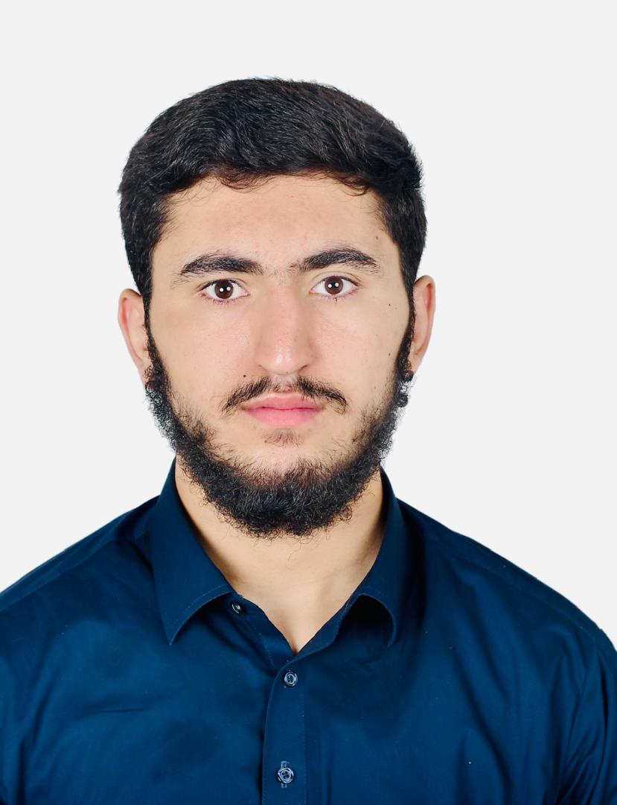

# تیم

لایاتناهی توسط یک تیم کوچک و متمرکز ساخته می‌شود که *کار را درست انجام دادن* برایشان مهم است — از برنامه‌ریزی و طراحی تا توسعه و بهبود. باور داریم سیستم‌های بزرگ از **کار تیمی پیوسته**، **ارتباط روشن** و تعهد به کیفیت در هر مرحله ساخته می‌شوند.

## اعضای تیم

  

    
    
<strong class="font-semibold text-zinc-900 dark:text-zinc-100">Najeebullah Saleh</strong> Founder / بنیان‌گذار

  

  

    
    
<strong class="font-semibold text-zinc-900 dark:text-zinc-100">Saifullah Munqad</strong> Product Manager / مدیر محصول

  

  

    
    
<strong class="font-semibold text-zinc-900 dark:text-zinc-100">Musab Munqad</strong> CEO / رئیس اجراییه

  

  

    
    
<strong class="font-semibold text-zinc-900 dark:text-zinc-100">JASUR</strong> Marketing Manager / مدیر بازارجویی

  

  

    
    
<strong class="font-semibold text-zinc-900 dark:text-zinc-100">Hedayatullah Samadee</strong> Designer / طراح

  

## تماس با ما

> **نکته:** پرسش درباره محصول، یک مشارکت، یا پشتیبانی؟ خوشحال می‌شویم بشنویم — صفحه **[تماس با تیم](/docs/support/contact-team)** را ببینید.

## صفحات مرتبط

- [مرور لایاتناهی](/docs/layatanahi/overview)
- [ایده](/docs/layatanahi/idea)
- [سپاس‌نامه](/docs/layatanahi/credits)
