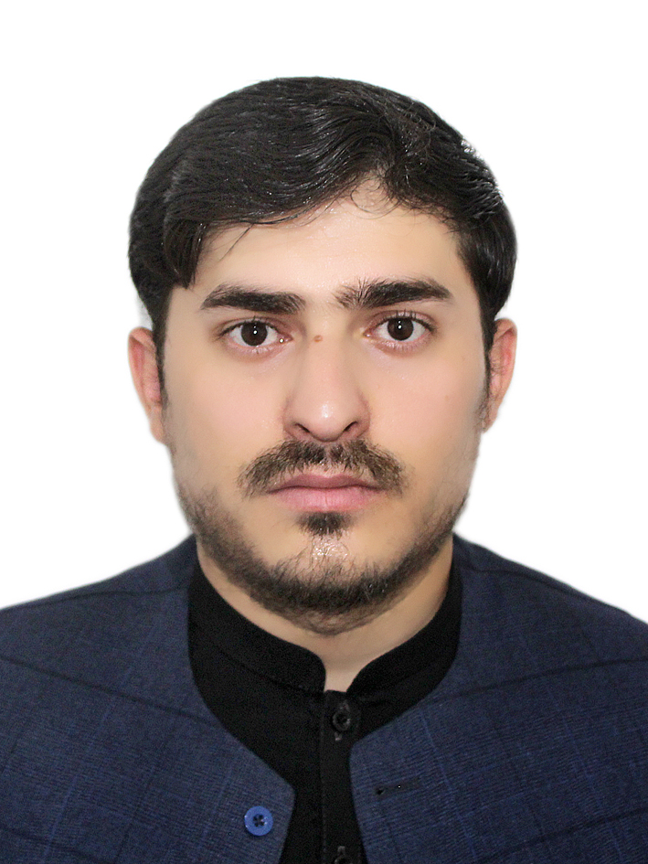
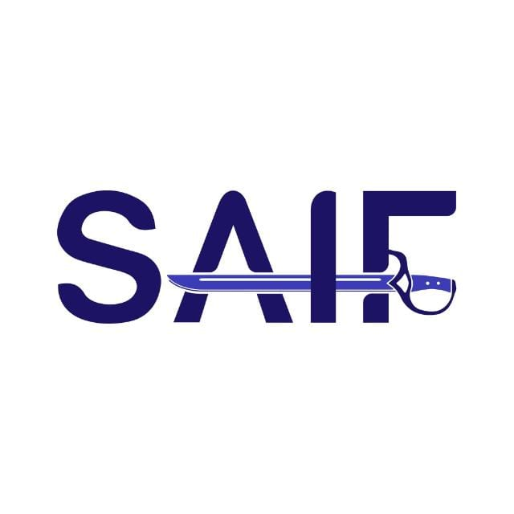
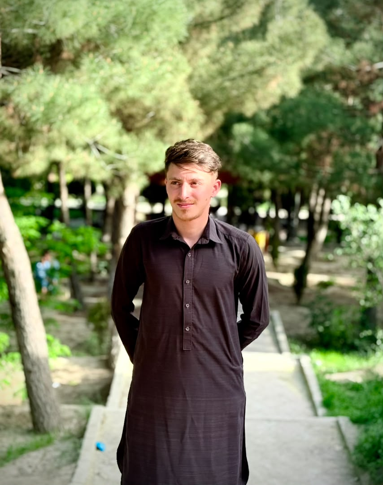
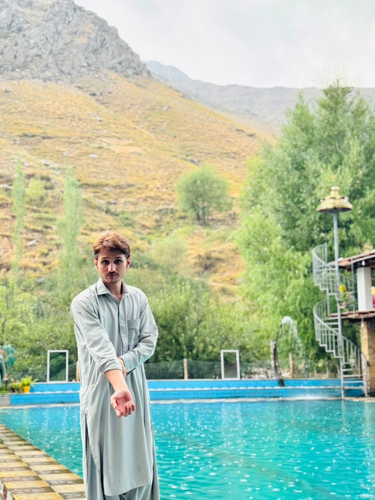
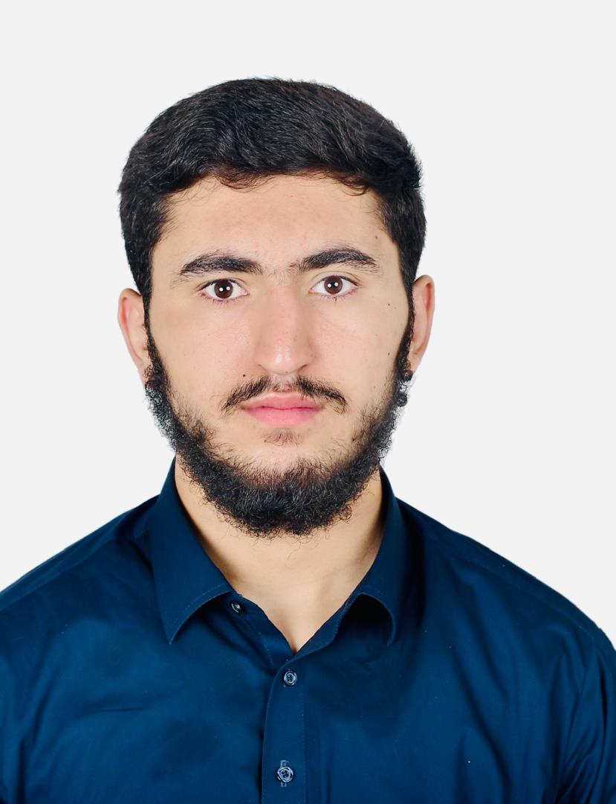

# زموږ ډله

لياتناهی د یوې کوچنۍ، متمرکې ډلې لخوا جوړېږي چې *کار سم ترسره کول* ورتې مهم دي — له طرحې او ډیزاین څخه تر پراختیا او اصلاح پورې. موږ باور لرو چې لوی سیسټمونه د **دوامداره ټیم‌کار**، **روښنو اړیکو** او په هر پړاو کې د کیفیت ژمنې څخه جوړېږي.

## زموږ غړي

  

    
    
<strong class="font-semibold text-zinc-900 dark:text-zinc-100">Najeebullah Saleh</strong> Founder / بنسټ ایښودونکی

  

  

    
    
<strong class="font-semibold text-zinc-900 dark:text-zinc-100">Saifullah Munqad</strong> Product Manager / د محصول مدیر

  

  

    
    
<strong class="font-semibold text-zinc-900 dark:text-zinc-100">Musab Munqad</strong> CEO / مشر اجراییه

  

  

    
    
<strong class="font-semibold text-zinc-900 dark:text-zinc-100">JASUR</strong> Marketing Manager / د بازارونو مدیر

  

  

    
    
<strong class="font-semibold text-zinc-900 dark:text-zinc-100">Hedayatullah Samadee</strong> Designer / ډیزاینر

  

## زموږ سره اړیکه

> **سپارښتنه:** د محصول، ملګرتیا یا ملاتړ په اړه پوښتنه لرې؟ خوښېږو چې ورته وغږېږو — **[له ډلې سره اړیکه](/docs/support/contact-team)** پاڼه وګوره.

## اړیندې پاڼې

- [د لياتناهی کتنه](/docs/layatanahi/overview)
- [نظریه](/docs/layatanahi/idea)
- [مننه‌لیک](/docs/layatanahi/credits)
